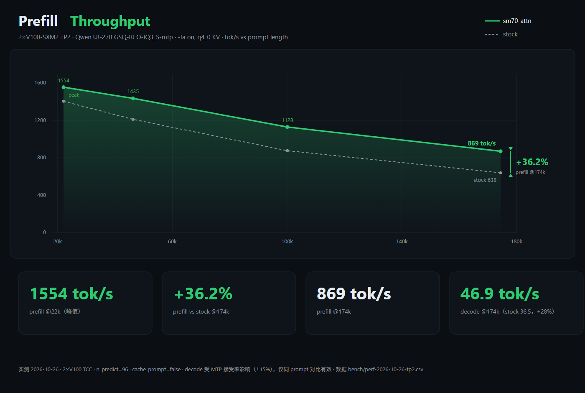
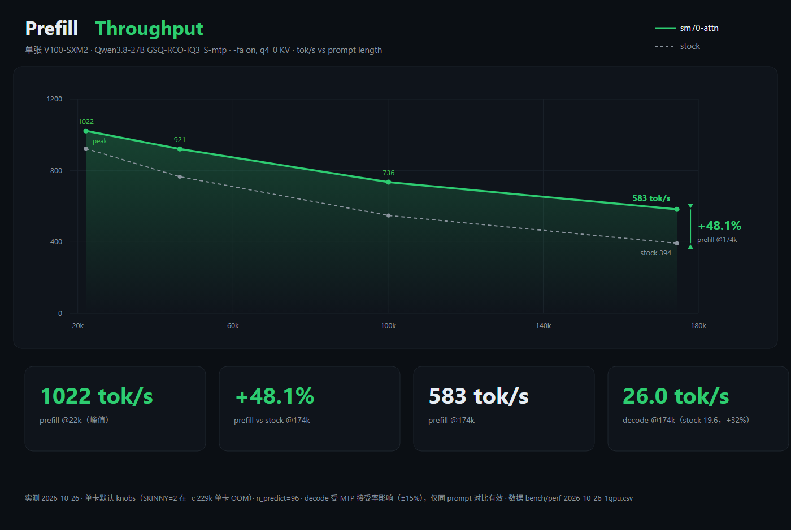

<div align="center">

# sm70-attn

**FlashAttention re-lit for Tesla V100 — a deep-custom fork of llama.cpp**

An SM 7.0 CUDA kernel plugin for Qwen3.5/3.6/3.8-27B (head_dim=256, GQA 6:1,
16 full-attention layers), scale-out to 2×V100 tensor parallelism over NVLink,
D256 tensor-core speculative decode, and a determinism story with gates that
catch regressions.


**English** · [中文](README.md)

</div>

---



## Why this fork exists

llama.cpp's stock flash-attention path has no tensor-core implementation for
SM 7.0 (Volta / Tesla V100). This repo ports a 1CatAI-verified Split-D N32 D256
kernel into llama.cpp master and builds the production stack on top of it:

**Prefill**
- Split-D D256 prefill kernel (the port), plus **SplitKV3** — 3-way KV split for
  long-prefix chunks (+3.4% at 174k);
- **f32 attention output end-to-end** — no f16 staging, so per-layer rounding is
  halved;
- **q4_0 in-kernel direct loads** (opt-in): XQA-style per-dtype template loads
  that read the raw block cache into the MMA fragments, no f16 mirror.

**Decode**
- **D256 tensor-core decode kernel** for speculative-verify widths (w≥2), with
  in-kernel q4_0 loads and a binary-search live-key bound;
- **adaptive KV splits** (`kv_len/920`, capped at 48) so deep-context decode
  keeps the whole SM grid busy;
- **IQ skinny repack** (opt-in): +8.7% decode at 174k, +7% prefill.

**GDN (linear attention)**
- **l2norm prologue fusion** (opt-in, bit-exact): folds the per-layer q/k
  RMS-norm + scale chain into the GDN kernel, eliding 4 nodes × 48 layers
  per decode pass. Bit-exact by construction (one float4 per lane + the same
  32-wide shuffle butterfly as `rms_norm_f32`): 0 / 16,384 elements differ.
  **No round-time gain at the tested operating points** (median round wall
  identical; the tok/s A/B is confounded by draft-acceptance variation) —
  archived as a negative performance result, default OFF — but the work
  found and fixed a 4× over-count in the previously uncalled fused reduce.

**Multi-GPU**
- **2×V100 tensor parallelism over NVLink** (TCC on Windows), including a
  one-shot **P2P allreduce** for prefill-sized messages — after the fix it is
  within noise of "no allreduce at all" on the 22k pass (739 → 1558–1612 tok/s).

**Correctness**
- **sm_70 dequant kernels** for iq3_s / iq3_xxs / iq4_xs, bit-exact against the
  stock dequant path, default on;
- two **determinism root causes** found and fixed (a dequant LUT overrun and a
  padded causal base), each with a gate that fails on the old code;
- mtmd + DFlash2 crash fix (upstream ggml-org#27408), and context-checkpoint
  persistence across server restarts.

Every behavior can be rolled back to the stock path with one environment
variable, bit-identically.

## Performance

Test box: 2×Tesla V100-SXM2-32GB (NVLink, TCC) + an RTX 3080 for the desktop.
Weights `Qwen3.8-27B-GSQ-RCO-IQ3_S-mtp`. Every number below is measured; the
raw data and the plotting script are in `bench/` and `docs/sm70-perf-inventory.md`.

### Production: 2×V100 TP2 (current best)

```
CUDA_VISIBLE_DEVICES=0,1
LLAMA_SM70_D256=1 LLAMA_SM70_D256_DECODE=1 LLAMA_SM70_D256_DEC_Q4=1
LLAMA_SM70_SKINNY=2 LLAMA_SM70_IQ_SKINNY=1
llama-server -m Qwen3.8-27B-GSQ-RCO-IQ3_S-mtp.gguf \
  -sm tensor -ngl 99 -fit off -c 229376 -b 4096 -ub 8192 \
  -fa on -ctk q4_0 -ctv q4_0 --spec-type draft-mtp --spec-draft-n-max 3 \
  -t 12 -tb 16 --temp 0 -np 1
```

Same server process, four prompts in sequence (`cache_prompt=false`,
`n_predict=96`, temp 0), tuned vs `LLAMA_SM70_D256=0` (stock):

| prompt tokens | prefill sm70-attn | prefill stock | prefill gain | decode sm70-attn | decode stock |
|---:|---:|---:|---:|---:|---:|
| 22,081 | **1554.1** | 1404.3 | +10.7% | 72.8 | 66.8 |
| 46,300 | **1435.1** | 1210.0 | +18.6% | 53.3 | 77.6 |
| 100,126 | **1128.5** | 875.0 | +29.0% | 47.7 | 59.2 |
| 174,479 | **869.5** | 638.3 | **+36.2%** | **46.9** | 36.5 |

- Best observed on the same build in other runs: **1612 tok/s @22k**,
  **878 tok/s @174k** (1–3% run-to-run spread).
- The gain grows with context because attention grows with context: at 174k it
  is ≈61% of the prefill wall; at 22k ≈14%.
- **Do not plot the decode column as a curve across prompts**: MTP acceptance
  depends on the generated text (±15%). Only the same-prompt pair is
  meaningful: **46.9 vs 36.5 = +28.5% at 174k**.
- Allreduce cost after the P2P fix: skipping it entirely measures 1591 tok/s
  @22k vs 1558–1612 with it, i.e. inside the run-to-run noise; it was 62% of
  the pass before the fix.

### Single V100 (same build, reference)



| prompt tokens | prefill sm70-attn | prefill stock | prefill gain | decode sm70-attn | decode stock |
|---:|---:|---:|---:|---:|---:|
| 22,081 | **1022.3** | 923.4 | +10.7% | 50.2 | 54.4 |
| 46,300 | **921.3** | 765.8 | +20.3% | 48.5 | 38.1 |
| 100,126 | **735.9** | 549.3 | +34.0% | 39.2 | 30.9 |
| 174,479 | **583.4** | 393.8 | **+48.1%** | **26.0** | 19.6 |

The single-card series runs the **default** skinny knobs: the TP2 recipe's
`LLAMA_SM70_SKINNY=2` (a second full copy of the quantized weights) does not fit
on one 32 GB card at `-c 229376` — it OOMs during load — and `IQ_SKINNY=1` alone
leaves zero headroom (32,439 MiB used of 32,768). Everything else matches the TP2
recipe. TP2 vs single card: prefill **+52% @22k, +49% @174k**.

Single-card decode mirrors the TP2 caveat: at 22k the tuned/stock pair is
inside the MTP-acceptance noise (−7.9%; the greedy texts diverge), but from 46k
on the KV-split decode kernel pays off clearly (+27% @46k/100k, +32% @174k).

### The 8/26 single-card A/B (historical)

The previous README's headline was measured on a different stack (Q4_K_XL,
`-ctv f16`, `-ub 512`, no TP2): 176k prefill **372.94 → 521.93 tok/s (+39.9%)**,
same binary, same prompt, `LLAMA_SM70_D256=0` vs default. It stays here as the
baseline that motivated the later work; it is not comparable to the tables
above.

### Where the remaining time goes

The D256 prefill kernel runs at **48.4 TFLOP/s = 38.7%** of the V100's 125
TFLOP/s on the 174k production shape. Ablation shows the cause is not the MMA:
133 ms of tensor-core work plus 225 ms of staging/softmax glue that does not
overlap with it (358 ms total). A bare-MMA probe explains the 38.7%: the SM
needs ~8 independent accumulator chains per warp to reach 97% of peak, and the
QK gemm only has 4. Ceiling with today's instruction mix: **225 ms (1.59×)**;
getting there needs a two-block ping-pong schedule, not another constant. Full
evidence: `docs/sm70-attn-d256-prefill-limit.md`.

## Quick start

```bash
# Build (CUDA >= 12.x, target GPU is Volta)
cmake -B build -DGGML_CUDA=ON
cmake --build build --target llama-server -j

# 2×V100 tensor parallel (production). On Windows/TCC:
#   - CUDA enumerates the two V100s first -> CUDA_VISIBLE_DEVICES=0,1
#   - -fit off is required, otherwise the loader tries to fit a layer on the CPU
#   - NVLink must be up (see "TP2 on 2×V100" below)
CUDA_VISIBLE_DEVICES=0,1 \
LLAMA_SM70_D256=1 LLAMA_SM70_D256_DECODE=1 LLAMA_SM70_D256_DEC_Q4=1 \
LLAMA_SM70_SKINNY=2 LLAMA_SM70_IQ_SKINNY=1 \
./build/bin/llama-server -m Qwen3.8-27B-GSQ-RCO-IQ3_S-mtp.gguf \
    -sm tensor -ngl 99 -fit off -c 229376 -b 4096 -ub 8192 \
    -fa on -ctk q4_0 -ctv q4_0 \
    --spec-type draft-mtp --spec-draft-n-max 3 \
    --host 127.0.0.1 --port 8080

# Single card (same flags minus -sm tensor and the two skinny knobs)
CUDA_VISIBLE_DEVICES=1 LLAMA_SM70_D256=1 LLAMA_SM70_D256_DECODE=1 \
LLAMA_SM70_D256_DEC_Q4=1 \
./build/bin/llama-server -m Qwen3.8-27B-GSQ-RCO-IQ3_S-mtp.gguf \
    -ngl 99 -fit off -c 229376 -b 4096 -ub 8192 \
    -fa on -ctk q4_0 -ctv q4_0 \
    --spec-type draft-mtp --spec-draft-n-max 3
```

Non-Volta / non-D256 / non-causal / small batch (ne[1]<256) falls back to the
llama.cpp native path automatically — no config needed.

### What does not work (measured, don't retry blindly)

| Setup | Result |
|:---|:---|
| WSL2 + TP2 | two V100s are not NVLink P2P-visible under GPU-PV; run on Windows/TCC |
| `--spec-type draft-dflash` × `-sm tensor` | assert in `ggml-backend-meta.cpp` (per-row op on an axis-0-split source); use `draft-mtp` |
| `-sm layer` for decode | zero decode gain (synchronous layer chain, no overlap); +39% prefill only |
| `-ub 16384` | OOM; 8192 is the prefill optimum (prefill is dequant-bound per ubatch) |
| `LLAMA_SM70_SKINNY=2` on one card | OOM (second weight copy); TP2-only |
| `q4-direct` as default | 42% slower kernel at 174k (narrow u16 loads); opt-in for VRAM only |
| `-O3 --use_fast_math` style kernel tweaks | already at the accumulator-chain limit, see the ceiling section |

## Environment variables

| Variable | Default | Effect |
|:---|:---:|:---|
| `LLAMA_SM70_D256` | `1` | Master switch; `0` = stock path, bit-identical |
| `LLAMA_SM70_SPLITKV3_MIN_KV` | `2048` | SplitKV3 activation threshold (kv_len); `0` disables |
| `LLAMA_SM70_D256_Q4_DIRECT` | `0` | In-kernel q4_0 direct loads (no f16 K/V mirror): saves VRAM, ~4% slower prefill |
| `LLAMA_SM70_D256_DECODE` | `0` | D256 tensor-core decode kernel (spec-verify widths w≥2) |
| `LLAMA_SM70_D256_DEC_Q4` | `0` | q4_0 direct loads in the decode kernel |
| `LLAMA_SM70_D256_SPLITS` | `0` | Decode KV-split cap override (`0` = auto `kv_len/920`, cap 48; max 256) |
| `LLAMA_SM70_DEQUANT_FAST` | `1` | sm_70 iq3_s/iq3_xxs/iq4_xs dequant kernels; `0` = stock dequant |
| `LLAMA_SM70_SKINNY` | `0` | q4_K skinny path: `1` = +10% pp / −28% tg, `2` = +9% pp + full decode but a second weight copy in VRAM |
| `LLAMA_SM70_IQ_SKINNY` | `0` | IQ skinny repack (+8.7% decode, +7% prefill @174k; large VRAM cost) |
| `LLAMA_SM70_D256_DEBUG` | `0` | Print kernel selection probes (ACCEPT/REJECT + reason) |
| `GGML_CUDA_P2P_AR_MAX_BYTES` | `176 MiB` | One-shot P2P allreduce message window; `0` disables that path |
| `GGML_CUDA_P2P_AR_NBLOCKS` | `80` | Allreduce blocks (≤ one per SM; more deadlocks) |
| `LLAMA_SM70_GDN_PROLOGUE` | `0` | GDN l2norm prologue fusion (bit-exact; `_DBG=1` match diagnostics, `_NOCACHE=1` disables the cpy fold) |
| `LLAMA_SM70_GDN_CHUNK` | `1` | GDN chunked (prefill) path; `0` disables |
| `LLAMA_SM70_STEP_PROF` | `0` | Round/subgraph wall ledger (P0, `ggml-backend-meta.cpp`); graphs-on safe |
| `SM70_DUMP` / `SM70_DUMP_KV` | off | Capture kernel inputs/outputs for offline repro & three-way blame |

## Validation gates

Every change is guarded by gates; all are self-contained and re-runnable
(`bash verify/<script>`, binaries built with `nvcc -arch=sm_70`):

| Gate | Content | Status |
|:---|:---|:---:|
| Kernel harness | 23 cases: dense / f32-out / spiky / pos-major K,V / SplitKV3 edge / q4-direct | **23/23** |
| Dequant parity | real launches, poisoned outputs, every call error-checked: iq3_s/iq3_xxs/iq4_xs bit-exact vs stock | **PASS** |
| Determinism | identical requests must give bit-identical last-token logprobs (554 / 22k / 174k; single and TP2) | **PASS** |
| logit A/B | greedy 128-token decode, zero divergence vs stock | **PASS** |
| Three-way blame | first-layer ON-vs-OFF at the f16 rounding floor (dense ~5e-4) | **PASS** |
| GDN prologue bit-exact | fused vs stock `rms_norm+scale`, 16,384 elements | **0 differ** |
| Multimodal | image request 200 + correct description + text acceptance 0.88 | **PASS** |
| Rollback | `LLAMA_SM70_D256=0` reproduces stock bit-for-bit | **PASS** |

The dequant parity gate is worth calling out: the previous version compared
host buffers that stayed zero when a kernel faulted, so it printed "BIT-EXACT"
for a kernel with an out-of-bounds LUT read. The current gate checks every
launch/copy, poisons the outputs, and forces finite fp16 scales; it fails loudly
on the old code and passes on the new.

## Fix archives (full causal chains)

### Context contamination (8/23, 9-line fix)

**Symptoms**: 23 "amnesia" signatures — the model continued recent context but
forgot everything earlier.

**Root cause**: the launcher assumed `to_fp16_nc` writes its dequant dst as
`[ne2][ne1][ne0]` (head-major); it actually linearizes as `[ne1][ne2][ne0]` =
position-major `[ctx][hkv][D]`. The head-major strides scrambled K on every
q4_0-K prefill: each full-attn layer output was off by ~0.69 relative error,
compounding into O(1) nat logit drift and greedy argmax flips.

**Diagnosis**: `sm70_variant_scan.py` pinned it in 12 minutes (the K-transposed
variant dropped |v-C| from 0.69 to 0.08). **Fix**: 9 lines; the `posK/posKV`
harness cases pin it forever.

### Multimodal + spec decode crash (8/24, upstream #27408)

**Symptoms**: an image under `--spec-type draft-dflash` crashed with
`llama_decode(ctx_dft) rc=-1` → HTTP 500 "failed to process mtmd chunk".

**Root cause**: multimodal batches arrive with a constant position per row (752
image rows all at pos 53; the spatial structure lives in the target's M-RoPE),
while the following text continues at `image_pos + grid_height`. The draft's 1-D
KV cache can store neither shape.

**Fix** (three changes in `common/speculative.cpp`): skip embedding batches in
`process()` and zero-fill the hole on the next token batch; place the draft's
noise block at the draft cache's own `pos_max + 1`; demote the pos_max-vs-N
warning to a debug heuristic. The target still validates every drafted token, so
the output distribution stays exact.

### Nondeterminism at ≥30k (10/26) — two independent root causes

Identical llama-server requests returned different tokens at 22k+ context. Both
causes were in sm70 code, and both produced *wrong values*, not just races:

1. **IQ4_XS dequant LUT overrun**: the high nibble was read as
   `(q >> 8j) >> 4` without masking, so a 32-bit word indexed a 16-entry table
   far out of bounds. The garbage depended on whatever was in memory, which is
   why the first prefill of a process differed from later ones. Fixed by
   `& 0xF` (`ac3c27910`); the fast dequant now matches the stock dequant bit-for-bit at 550
   and 22,081 tokens.
2. **D256 prefill causal base from the padded key count**: the launcher passed
   `kv_len - q_len`, but `mask->ne[0]` is padded up for tiling, so the first rows
   saw future tokens and the last rows read stale padding columns (the previous
   request's KV). Fixed by resolving the live key count from the last mask row (`315dbb08e`) —
   the same monotone binary search the decode kernel uses.

Also fixed in the same pass: the old dequant gate was vacuous (see Validation
gates). New gates: identical logprobs across identical requests at 554 / 22k /
174k, single-card and TP2.

### TP2 prefill was slower than one card (10/26) — the allreduce window

Symptom: tensor-parallel prefill was *slower* than one card — 739 tok/s at 22k
vs 765 on the same build and prompt with a single GPU (and 502 at 174k). Skipping
the allreduce entirely (timing only) showed it was 62% of the pass.

**Root cause**: the one-shot P2P allreduce had a 1 MiB message window. The
`[n_embd × ub]` f32 partial of a prefill is 11 MB at 554 tokens and 168 MB at
8192, so it missed the NVLink path and fell into the host-staged copy-engine
reduce: ~122 ms per message at 1.4 GB/s over PCIe, twice per layer.

**Fix** (four commits in `allreduce-p2p.cu`): `627961dc0` raises the default
window to 176 MiB (739 → 1472 tok/s at 22k, with the reduce still ~25% of the
wall); `597028032` goes 16 → 80 blocks (one per SM; 1472 → 1514 →
1544 tok/s); `4463259d1` stages into peers only and starts the reduction from
the local source (halves the staging traffic); `17cc119fc` publishes with
`__threadfence()` instead of `__threadfence_system()` since both the slice and
the flag land in peer device memory. Result: **739 → 1558–1612 tok/s at
22k, 502 → 878 at 174k**; the AR-skip A/B at 22k now reads 1591 vs
1558–1612, i.e. inside the run-to-run noise.

## Technical deep dives

### SplitKV3

For long-prefix chunks (kv_len ≥ threshold) the KV sweep is split 3 ways across
`gridDim.y`, tripling the CTA count so late chunks stop serializing their KV
scan; a merge kernel combines the partial (max, sum, numerator) triples.
Measured today at the 174k production shape: 357.7 ms vs 370.0 ms dense
(+3.4%). Edge case upstream misses: a row's causal window can be fully masked
inside one segment, so the SplitKV3 instantiation initializes `row_max` to
−1e30 (not −inf) to keep `(-inf)-(-inf)=NaN` out of the partial chain, and the
merge guards a zero denominator.

### q4-direct: why default OFF

The kernel has `Kq4/Vq4` template branches that read the raw q4_0 block cache
(`[ctx][head][block]`, byte strides) and dequantize straight into the register
fragments / smem panels. Rounding is bit-identical to the staged `to_fp16` path
(verified by harness and logit A/B). Measured at 174k: the kernel is **42%
slower** with q4-direct (507 vs 358 ms), while the whole-cache f16 staging it
replaces costs only ~0.1 s of a 770 s prefill. Net: the opt-in trades prefill
speed for the f16 mirror's VRAM — only worth it when memory-bound.

### Decode path

Deep-context decode is a latency problem, not a bandwidth one: KV reads are a
tiny fraction of a step, but a fixed number of CTAs leaves the SM grid idle.
Three layers of work fixed that: the D256 TC decode kernel (GQA-packed rows for
spec-verify widths, q4-direct loads, binary-search live bound), adaptive KV
splits (`kv_len/920`, cap 48), and the IQ skinny repack. Measured 174k decode
ladder: 15.1 → 24.0 (single card + spec) → 34.99 (TP2 + GSQ + MTP3) → 37.37
(+P2P allreduce) → 43.5 (adaptive splits) → **47.3** (+IQ skinny), 46.9 in the
chart above.

### TP2 on 2×V100 (TCC, NVLink)

- NVLink 2.0 ×6 links: 145.1 / 144.9 GB/s one-way, 289.6 GB/s aggregate
  (98% of the 300 GB/s theoretical);
- TCC on both V100s: needed for reliable P2P; on Windows the CUDA enumeration
  order is [V100, V100, 3080], so use `CUDA_VISIBLE_DEVICES=0,1`;
- `-fit off` is mandatory: otherwise the loader tries to fit a layer on the CPU;
- TP is a meta backend: per-subgraph dispatch + host-driven allreduce at two
  boundaries per layer (130 reduce points per prefill pass);
- DFlash draft is incompatible with TP (assert); `draft-mtp` works and is the
  production spec decoder.

### Upstream (1Cat-vLLM) status: exhausted

- **Prefill kernels**: Split-D vendored + fixed + SplitKV3 — eaten clean;
- **XQA decode kernel (3490 lines)**: not ported as-is; the D256 TC decode
  kernel covers our verify widths, and the ladder above shows the remaining
  gains were scheduling, not the kernel;
- **TurboQuant / FP8 KV / paged layout converters**: private quant formats and
  vLLM-specific infrastructure, not portable at kernel level;
- **flash_qla (GDN linear attention)**: the GDN layers are now profiled at the
  round level (P0 step profiler): the fused prologue elides 192 launches per
  pass for no measurable gain, and the budget sits in host orchestration and
  the weight stream (`docs/sm70-gdn-prologue-fusion.md`);
- **smem bank-padding know-how**: our vendor kernel already ships pitch-68 +
  Swizzle<3,3,3> + TT-swizzled V layouts.

### Known limits and next levers

- Attention is ≈61% of the 174k prefill wall and the kernel is at 38.7% of
  peak; further attention gains need the ping-pong rewrite described in
  `docs/sm70-attn-d256-prefill-limit.md`.
- Per-round budget at ~30k decode (P0 step profiler,
  `docs/sm70-gdn-prologue-fusion.md`): meta host orchestration ~3.5-4.0 ms per
  forward pass (55 subgraph computes per round, each through
  `ggml_backend_sched` + a CUDA graph launch), and the weight stream runs at
  ~43% of roofline (~10.4 ms GPU-busy per card per round vs a ~3.2 ms floor at
  900 GB/s). The next levers are one-graph dual-device capture and a fused
  dequant TC GEMM, not more glue-kernel elision.

## Tooling

Everything is self-contained and runs on the physical box.

`verify/` — correctness and microbenchmarks:
- `sm70_verify.cu` / `run.sh` — 23-case kernel harness, CPU f32 reference, md5
  pin on the kernel source;
- `sm70_dequant_parity.cu` — real-launch dequant parity gate (error-checked,
  poisoned outputs);
- `sm70_attn_micro.cu` — standalone D256 prefill benchmark at production
  geometry (SplitKV3 / q4-direct / dense switchable, naive reference check);
- `sm70_mma_peak.cu` — bare `mma.sync.m8n8k4` peak vs accumulator-chain count;
- `sm70_gdn_prologue_bitexact.cu` / `sm70_gdn_prologue_microtest.cu` — GDN
  prologue fusion: bit-exactness (0/16384) and the 4× reduce over-count the
  microtest exposed;
- `ggml/src/ggml-cuda/step-prof.h` + `ggml-step-prof.h` — P0 round/subgraph
  wall ledger (env-gated, zero cost when off);
- `sm70_gemm_micro.cu` — cuBLAS vs dequant-then-cuBLAS on production GEMM shapes;
- `ablate.py` — generates timing-only kernel variants (`if (false)` on one
  inner-loop phase) without touching the production header;
- `sm70_layer_diff.py` / `sm70_variant_scan.py` / `sm70_repro.py` /
  `dump_*.sh` — the 8/23 three-way blame kit;
- `logit_ab_fixed.sh`, `perf_ab*.sh` — logit verdict and throughput acceptance.

`bench/` — workloads and measurement:
- `prompt_46k.txt`, `prompt_176k.txt` — standard / ROI prefill workloads;
- `perf-2026-10-26-tp2.csv` — the TP2 sweep in the table above;
- `plot_sm70_perf.py` + `shot_chart.bat` — dependency-free chart generator
  (HTML+SVG) and the headless-browser rasterizer;
- `D:\zcode-build\sweep_perf.py`-style sweeps live outside the repo (they need
  the model and the servers).

## Repository layout

```
ggml/src/ggml-cuda/
├── fattn.cu                      # selection hook (cc==700 + D256 + causal + prefill/decode width)
├── fattn-sm70-d256.cu            # prefill launcher: Q staging / K,V dequant / SplitKV3 / scatter
├── fattn-sm70-d256-kernel.cuh    # Split-D N32 D256 kernel + SplitKV3 + q4-direct branches
├── fattn-sm70-d256-decode.cuh    # D256 tensor-core decode kernel (GQA-packed verify widths)
├── allreduce-p2p.cu              # one-shot P2P allreduce (TP2 prefill path)
├── dequant-sm70.cuh              # sm_70 iq3_s / iq3_xxs / iq4_xs dequant kernels
├── gated_delta_net.cu            # GDN kernels + opt-in l2norm prologue fusion
├── q4k-skinny.cu / iq-skinny.cu  # skinny weight layouts (opt-in)
└── sm70-vendor/                  # cute/cutlass (Apache-2.0) + flash (BSD-3)
verify/                           # harnesses, ablation generator, blame tooling
bench/                            # workloads, sweep CSV, chart generator
docs/sm70-*.md                    # decode port plan, determinism findings, GDN fusion,
                                  # kernel ceiling, perf inventory
```

## Branches & sync

- `main`: upstream master + the plugin (baseline 2026-08-18 =
  ggml-org/llama.cpp `25ae3a9b3`; last catch-up merge 2026-10-24,
  upstream `280141e6d4`).
- The physical build box only does `git pull && cmake --build build`.
- Upstream conflicts are limited to workflow deletions (no docker/release
  pipelines in this fork).

## Commit chain (selected)

- `be7c77734` — v1.0 hook (pipeline validation, stock kernel)
- `00d7c8b57` — v1.1 real SM70 D256 Split-D kernel + vendor closure
- `284b251` — **8/23 stride fix** (the 0.69 root cause; K/V dequant strides are
  position-major)
- `2722ed274` — f32 attention output end-to-end
- `b472e483f` + `fd718f946` — **SplitKV3** port + NaN edge fix
- `c96bae56d` — q4-direct in-kernel loads, verdict keeps it opt-in
- `1921132d8` — SplitKV3 merge denominator guard (10/13)
- `25caf6bec` / `a2e69d08e` / `0a6f6e8d0` — D256 TC decode kernel (WP1 P1/P2) and
  the verify-width routing with the prefetch negative result archived
- `b32348e2e` — Windows tooling + V100 TCC mode switch
- `968e69a6d` — one-shot P2P allreduce port
- `cb3d4806f` / `1a1148d0c` — adaptive decode splits / IQ skinny repack
- `40420489b` / `3b85a5dea` — sm_70 dequant kernels, finalized and real-machine
  validated
- `76d71f7cc` / `da38b1363` — step profiler (P0) + GDN l2norm prologue fusion
  (P1, opt-in, bit-exact) and the determinism localization
- `ac3c27910` — **iq4_xs dequant LUT overrun fix** (determinism root cause 1)
- `315dbb08e` — **D256 prefill causal base from the mask** (root cause 2)
- `627961dc0` / `597028032` / `4463259d1` / `17cc119fc` — **P2P allreduce
  window, block count, self-staging and fence** (TP2 prefill 739 → 1558–1612)

## Credits & license

- [1CatAI/1Cat-vLLM](https://github.com/1CatAI/1Cat-vLLM) — upstream source of
  the Split-D D256 kernel and the SplitKV3 patch
- [zhinianqin/flash-attention-v100](https://github.com/zhinianqin/flash-attention-v100)
  — FA2 base layer (BSD-3)
- [NVIDIA/cutlass](https://github.com/NVIDIA/cutlass) — CuTe/CUTLASS header
  closure (Apache-2.0)
- [ggml-org/llama.cpp](https://github.com/ggml-org/llama.cpp) — host (MIT)
- WyvernTKC/llama.cpp-4xV100 — the one-shot P2P allreduce design this port is
  adapted from (MIT)

Human–AI collaboration: AI-assisted commits carry a
`Co-authored-by: Hermes-Tianji <hermes-tianji@users.noreply.github.com>`
trailer. The 08-18..08-24 commits (including the 9-line stride fix) and five
2026-08-26 commits predate that convention and were pushed without it; this line
covers them.

License follows upstream: MIT (llama.cpp parts) + BSD-3 (flash vendor) +
Apache-2.0 (cutlass vendor).
